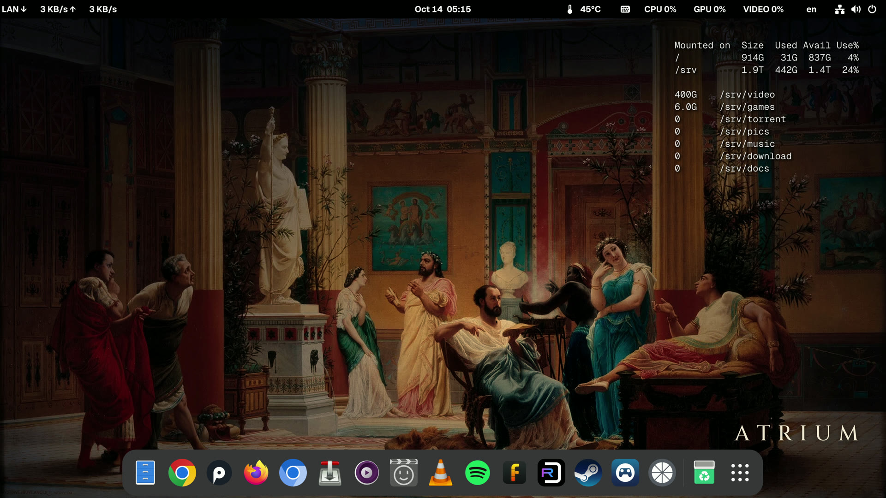

# atrium

**A home media PC for the TV on Fedora + GNOME: 4K at 120 Hz, HDR, bit-perfect audio, games, torrents
and a network share — in one quiet palm-sized box.**
*Домашний медиацентр у ТВ на Fedora + GNOME. Русская версия — ниже, после английской.*

[](docs/img/atrium-desktop-4k.jpg)

*The desktop as it is now: the top bar with network speed, temperature and CPU / GPU / video-decoder load,
disk usage on the desktop, the dock with all programs. Click for the full 4K picture.*


*The box, Beelink SER5 MAX. Photo: Beelink, from the
[product listing on Amazon](https://www.amazon.com/dp/B0FGHS3T6D) (shown by link, not stored in this
repository).*

This repository holds everything needed to build the same atrium from scratch with nothing but the
hardware:

- a step-by-step install with the reason for every step;
- BIOS and TV settings;
- HDMI 2.1 (4K 120 Hz, HDR) on the box's own port with one kernel parameter — and the month it took us
  to get there;
- all configs and our own programs;
- patches;
- what breaks on updates and how to get it back;
- variants we tried and no longer use, kept with their docs.

## What it is

A small computer (Beelink SER5 MAX) next to a big OLED TV. It looks and behaves like a set-top box:
- it boots straight to the desktop;
- you control it from a phone, a gamepad or a mouse;
- it never asks anything and never shows notifications.

Inside it is a full Linux server that runs around the clock.

### What it does

- **Films at their best.** mpv with the maximum-quality profile: 4K HDR and Blu-ray remuxes without
  dropped frames, decoded by the GPU. The preferred audio track is picked automatically, subtitles on
  demand.
- **Picture.** 3840×2160 at **120 Hz**, full **RGB 4:4:4**, **HDR10** (BT.2020 / PQ), 10-bit, no
  compression — over the box's own HDMI 2.1 with an ordinary cable, no active adapters. The desktop runs
  in SDR, HDR turns on by itself for HDR films in mpv. 24p films on 120 Hz are shown evenly, every frame
  5 times, no judder.
- **Bit-perfect sound.** An external USB DAC is the only sound card. The sample rate follows the track,
  44.1 to 192 kHz, without resampling.
- **Music.** fooyin (foobar2000-like) for files, Spotify.
- **Browser.** Chrome with Widevine (streaming services), Firefox.
- **Games.**
  - RetroDECK: PS1, PS2, PS3, PSP and more, with a gamepad menu;
  - Steam with Proton;
  - streaming games from a powerful PC at 3840×2160, **120 fps**, AV1 (Apollo → Moonlight), Steam Link.
- **Torrents.** The daemon always runs. Drop a `.torrent` into the share from any computer and the film
  downloads straight to the 2 TB drive.
- **Windows share** without passwords: `\\atrium.lan\media`, visible in Network.
- **Control.**
  - from a phone: touchpad and keyboard, types Cyrillic and any symbols;
  - RDP from a PC: the same screen;
  - SSH; DualSense and Xbox gamepads; an on-screen keyboard.
- **Apple Aerial screensaver.** After 15 minutes idle — Apple's 4K clips (cities, nature, the ISS, the
  ocean), after 30 minutes the screen turns off. Any touch brings everything back. It never interrupts a
  film.
- **Quiet and frugal.** The CPU draws 3–4 W when idle.
- **You see what is going on.**
  - the top bar shows CPU, GPU and video-decoder load: you see at once whether the GPU or the CPU plays
    the film;
  - network speed and temperature;
  - disk usage on the desktop;
  - a status summary at SSH login.

### Hardware

| | |
|---|---|
| Box | Beelink SER5 MAX: AMD Ryzen 7 7735U (8 cores / 16 threads, up to 4.75 GHz), Radeon 680M, 24 GB LPDDR5 |
| Drives | NVMe 1 TB (system) + WD Blue SN5000 2 TB (media, second M.2 slot) |
| Network | 2.5 GbE, Wi-Fi 6, Bluetooth |
| TV | LG OLED65C3 over HDMI 2.1, a passive Ultra High Speed (48G) cable |
| Sound | SMSL USB DAC |
| Software | Fedora 44, GNOME 50 (Wayland), kernel 7.2, Mesa 26.2 |

Hardware decoding: H.264, HEVC (incl. 10-bit), VP9 and AV1.

### Why this and not something else

- **Apple TV 4K.** A great box for subscriptions. But your own files over the network, bit-perfect sound
  through a DAC, torrents, a browser, PC games and emulators are missing there, or come only through
  third-party apps with limits.
- **Mac mini.** A Mac is a computer, not a TV player. It is faster, quieter and more frugal, and it has
  native HDMI 2.1. But:
  - the M6 with 24 GB and 1 TB costs $1,599 at the Apple Store, and the memory and storage are soldered for
    good. Here a second M.2 slot took 2 TB for about $300;
  - on macOS only some players switch the DAC rate per track;
  - Steam on Linux runs noticeably more games through Proton than on macOS.
- **A Windows mini PC.**
  - updates reboot it on their own, the system shows ads and notifications;
  - in HDR the desktop and normal video get dark. For us Windows was dark in HDR, while GNOME shows SDR
    content at normal brightness in HDR;
  - here: not a single popup, updates only by hand from the console, every setting written down in this
    repository.
- **Nvidia Shield and Android boxes.** Fine for Kodi and subscriptions, but 2019 hardware. No PC games, no
  PS3 emulation, no server.

### What it costs (approx., $)

| Box | 2 TB SSD | 48G HDMI cable | DAC | Total without the TV |
|---|---|---|---|---|
| ~500 | ~300 | ~15 | 150–250 | **≈ 970–1070** |

US prices, October 2026: the box from the Amazon listing above, the SSD (WD Blue SN5000 2 TB) on Amazon.
They change over time: in 2025 the same SSD cost $100–180.

## Documentation

| | English | Русский |
|---|---|---|
| Install from scratch, step by step | [docs/en/install.md](docs/en/install.md) | [docs/ru/install.md](docs/ru/install.md) |
| Hardware, BIOS, TV, drives | [docs/en/hardware.md](docs/en/hardware.md) | [docs/ru/hardware.md](docs/ru/hardware.md) |
| TV output: HDMI 2.1, a month of searching and where the truth was | [docs/en/tv-output.md](docs/en/tv-output.md) | [docs/ru/tv-output.md](docs/ru/tv-output.md) |
| Game streaming: Apollo, Moonlight, Steam Link, the network | [docs/en/streaming.md](docs/en/streaming.md) | [docs/ru/streaming.md](docs/ru/streaming.md) |
| Updates: what breaks and how to get it back | [docs/en/updates.md](docs/en/updates.md) | [docs/ru/updates.md](docs/ru/updates.md) |
| Known problems and fixes | [docs/en/problems.md](docs/en/problems.md) | [docs/ru/problems.md](docs/ru/problems.md) |
| Browser tests: how we measure video smoothness, every result | [docs/en/browser-tests.md](docs/en/browser-tests.md) | [docs/ru/browser-tests.md](docs/ru/browser-tests.md) |

## What is where

```
rootfs/      our files at exactly the paths they have on atrium:
             rootfs/etc/samba/smb.conf  ->  /etc/samba/smb.conf
             (configs, services, scripts, our GNOME extensions, wallpaper, TV user settings)
patches/     the Unified Remote patch (only our changes on top of the vendor files)
src/         sources and extras:
  dconf/       GNOME settings of the TV user
  wallpaper/   wallpaper generator; variants/ - the earlier wallpapers (robot, day painting)
  urserver/    Unified Remote on-screen keyboard builder
  pc/          Windows PC scripts for Apollo (wallpapers back after a stream, stop hotkey)
  tools/       atrium-browser-bench.py - measures dropped frames in browsers remotely
  variants/    ways we used before: dp-cable/ - the active DP -> HDMI 2.1 cable path
  intel-nuc/   versions for the previous box, an Intel NUC
lists/       installed packages and flatpak apps
docs/        documentation in English and Russian; img/ - screenshots
```

What is **not** here:

- **Secrets.** Passwords, keys and Wi-Fi profiles are set by each person during the install.
- **Third-party software and media.** Unified Remote, third-party GNOME extensions, firmware, BIOS, Apple
  Aerial clips, product photos. The docs give links, versions and checksums for them.
- **Personal values.** The domain (`example.com`), the home network (`192.168.0.0/24`, the box at
  `192.168.0.42`) and the time zone (`UTC`) are examples — set your own.

## Licenses

- **Ours** — scripts, configs, `atrium-*` extensions, the patch, generators, documentation, screenshots:
  MIT, see `LICENSE`.
- **Wallpaper** — Gustave Boulanger, "Rehearsal of 'The Flute Player' in the atrium of the Pompeian house
  of Prince Napoleon" (1861), public domain, our edit.
- **Cinzel font** (the caption on the wallpaper) — SIL Open Font License 1.1, `src/wallpaper/Cinzel-OFL.txt`.
- **Box photo** — © Beelink, shown by link from the product listing, not stored here.
- **Unified Remote** belongs to its vendor. The patch holds only our changes; no vendor files are in this
  repository.

---

# atrium (по-русски)

**Домашний медиацентр у ТВ на Fedora + GNOME: 4K 120 Гц, HDR, звук бит в бит, игры, торренты и общая
папка — в одной тихой коробке размером с ладонь.**

Снимок рабочего стола и фото бокса — в начале страницы.

В этом репозитории всё, чтобы собрать такой же atrium с нуля, имея на руках только железо:

- пошаговая установка с объяснением каждого шага;
- настройки BIOS и ТВ;
- HDMI 2.1 (4K 120 Гц, HDR) на штатном порту одним параметром ядра — и как мы к этому месяц шли;
- все конфиги и наши программы;
- патчи;
- что ломается при обновлениях и как это вернуть;
- варианты, которые мы пробовали и больше не используем, — с описанием.

## Что это

Маленький компьютер (Beelink SER5 MAX) у большого OLED-телевизора. Выглядит и ведёт себя как
приставка:
- включился и сразу показывает рабочий стол;
- управляется с телефона, геймпада или мыши;
- никогда ничего не спрашивает и не показывает уведомлений.

Внутри это полноценный Linux-сервер, который работает круглые сутки.

### Что умеет

- **Кино в лучшем качестве.** mpv с максимальным профилем: 4K HDR и Blu-ray Remux без пропусков кадров,
  видео декодирует видеокарта. Русская дорожка выбирается сама, субтитры по желанию.
- **Картинка.** 3840×2160 при **120 Гц**, полный цвет **RGB 4:4:4**, **HDR10** (BT.2020 / PQ), 10 бит,
  без сжатия — по штатному HDMI 2.1 обычным кабелем, без активных переходников. Рабочий стол в SDR, HDR
  включается сам на HDR-фильмах в mpv. Фильм 24p на 120 Гц показывается ровно, каждый кадр по 5 раз, без
  рывков.
- **Звук бит в бит.** Внешний USB-ЦАП — единственная звуковая карта. Частота сама подстраивается под
  трек, от 44,1 до 192 кГц, без пересчёта.
- **Музыка.** fooyin (как foobar2000) для файлов, Spotify.
- **Браузер.** Chrome с Widevine (стриминговые сервисы), Firefox.
- **Игры.**
  - RetroDECK: PS1, PS2, PS3, PSP и другие консоли, с меню для геймпада;
  - Steam через Proton;
  - стрим игр с мощного ПК в 3840×2160 при **120 к/с**, AV1 (Apollo → Moonlight), Steam Link.
- **Торренты.** Демон работает всегда. Бросил `.torrent` в общую папку с любого компьютера — фильм
  качается прямо на диск 2 ТБ.
- **Общая папка для Windows** без паролей: `\\atrium.lan\media`, видна в «Сети».
- **Управление.**
  - с телефона: тачпад и клавиатура, печатает и кириллицу, и любые символы;
  - RDP с компьютера: тот же экран;
  - SSH; геймпады DualSense и Xbox; экранная клавиатура.
- **Заставка Apple Aerial.** Через 15 минут простоя — ролики Apple в 4K (города, природа, МКС, океан),
  через 30 минут экран гаснет. Любое касание возвращает всё обратно. Пока идёт фильм, заставка не мешает.
- **Тихо и экономно.** В простое процессор тратит 3–4 Вт.
- **Видно, что происходит.**
  - в панели — загрузка CPU, GPU и аппаратного декодера: сразу видно, кто играет фильм, видеокарта или
    процессор;
  - скорость сети и температура;
  - на рабочем столе — заполнение дисков;
  - при входе по SSH — сводка состояния.

### Железо

| | |
|---|---|
| Бокс | Beelink SER5 MAX: AMD Ryzen 7 7735U (8 ядер / 16 потоков, до 4,75 ГГц), Radeon 680M, 24 ГБ LPDDR5 |
| Диски | NVMe 1 ТБ (система) + WD Blue SN5000 2 ТБ (медиа, второй слот M.2) |
| Сеть | 2,5 GbE, Wi-Fi 6, Bluetooth |
| ТВ | LG OLED65C3 по HDMI 2.1, пассивный кабель Ultra High Speed (48G) |
| Звук | USB-ЦАП SMSL |
| Софт | Fedora 44, GNOME 50 (Wayland), ядро 7.2, Mesa 26.2 |

Аппаратно декодируются H.264, HEVC (вкл. 10 бит), VP9 и AV1.

### Почему так, а не иначе

- **Apple TV 4K.** Отличная приставка для подписок. Но своих файлов по сети, звука бит в бит через ЦАП,
  торрентов, браузера, ПК-игр и эмуляторов на ней нет, либо всё это через сторонние приложения и с
  ограничениями.
- **Mac mini.** Mac — это компьютер, а не плеер для ТВ. Он быстрее, тише и экономнее, и HDMI 2.1 у него
  свой. Но:
  - M6 с 24 ГБ и 1 ТБ стоит $1599 в Apple Store, а память и диск распаяны навсегда. Здесь второй слот
    M.2: 2 ТБ добавили примерно за $300;
  - частоту ЦАПа под трек на macOS переключают только отдельные плееры;
  - игр в Steam под Linux через Proton заметно больше, чем под macOS.
- **Мини-ПК на Windows.**
  - обновления сами перезагружают машину, система показывает рекламу и уведомления;
  - в HDR рабочий стол и обычное видео становятся тёмными. У нас Windows в HDR была тёмной, а GNOME
    показывает SDR-контент в HDR с нормальной яркостью;
  - здесь: ни одного всплывающего окна, обновления только вручную из консоли, каждая настройка записана
    в этом репозитории.
- **Nvidia Shield и Android-приставки.** Хороши для Kodi и подписок, но железо 2019 года. Ни ПК-игр, ни
  эмуляции PS3, ни сервера.

### Сколько стоит (примерно, $)

| Бокс | SSD 2 ТБ | Кабель HDMI 48G | ЦАП | Итого без ТВ |
|---|---|---|---|---|
| ~500 | ~300 | ~15 | 150–250 | **≈ 970–1070** |

Цены в США, октябрь 2026: бокс — по объявлению на Amazon (ссылка в начале страницы), SSD (WD Blue SN5000
2 ТБ) — на Amazon. Цены меняются: в 2025 году этот же SSD стоил $100–180.

## Документация

| | Русский | English |
|---|---|---|
| Установка с нуля, по шагам | [docs/ru/install.md](docs/ru/install.md) | [docs/en/install.md](docs/en/install.md) |
| Железо, BIOS, ТВ, диски | [docs/ru/hardware.md](docs/ru/hardware.md) | [docs/en/hardware.md](docs/en/hardware.md) |
| Вывод на ТВ: HDMI 2.1, месяц поисков и где была правда | [docs/ru/tv-output.md](docs/ru/tv-output.md) | [docs/en/tv-output.md](docs/en/tv-output.md) |
| Стрим игр: Apollo, Moonlight, Steam Link, сеть | [docs/ru/streaming.md](docs/ru/streaming.md) | [docs/en/streaming.md](docs/en/streaming.md) |
| Обновления: что отлетает и как вернуть | [docs/ru/updates.md](docs/ru/updates.md) | [docs/en/updates.md](docs/en/updates.md) |
| Известные проблемы и решения | [docs/ru/problems.md](docs/ru/problems.md) | [docs/en/problems.md](docs/en/problems.md) |
| Тесты браузеров: как меряем плавность видео, все результаты | [docs/ru/browser-tests.md](docs/ru/browser-tests.md) | [docs/en/browser-tests.md](docs/en/browser-tests.md) |

## Что где лежит

```
rootfs/      наши файлы ровно по тем путям, где они лежат на atrium:
             rootfs/etc/samba/smb.conf  ->  /etc/samba/smb.conf
             (конфиги, службы, скрипты, наши расширения GNOME, обои, настройки пользователя ТВ)
patches/     патч для Unified Remote (только наши правки поверх файлов производителя)
src/         исходники и дополнения:
  dconf/       настройки GNOME пользователя ТВ
  wallpaper/   генератор обоев; variants/ - прежние обои (робот, дневная картина)
  urserver/    сборка экранных клавиатур Unified Remote
  pc/          скрипты ПК с Windows для Apollo (обои после стрима, клавиши остановки)
  tools/       atrium-browser-bench.py - удалённый замер пропусков кадров в браузерах
  variants/    способы, которыми пользовались раньше: dp-cable/ - путь через активный кабель DP -> HDMI 2.1
  intel-nuc/   версии для прежнего бокса Intel NUC
lists/       установленные пакеты и flatpak-приложения
docs/        документация на русском и английском; img/ - снимки экрана
```

Чего здесь **нет**:

- **Секретов.** Пароли, ключи и профили Wi-Fi каждый задаёт сам при установке.
- **Чужих программ и медиа.** Unified Remote, сторонние расширения GNOME, прошивки, BIOS, ролики Apple
  Aerial, фото товаров. Для них в документации есть ссылки, версии и контрольные суммы.
- **Личных значений.** Домен (`example.com`), домашняя сеть (`192.168.0.0/24`, бокс — `192.168.0.42`) и
  часовой пояс (`UTC`) — примеры, поставь свои.

## Лицензии

- **Наше** — скрипты, конфиги, расширения `atrium-*`, патч, генераторы, документация, снимки экрана: MIT,
  см. `LICENSE`.
- **Обои** — картина Гюстава Буланже «Репетиция „Флейтиста“ в атриуме помпейского дома принца
  Наполеона» (1861), общественное достояние, в нашей обработке.
- **Шрифт Cinzel** (подпись на обоях) — SIL Open Font License 1.1, `src/wallpaper/Cinzel-OFL.txt`.
- **Фото бокса** — © Beelink, показано ссылкой из листинга товара, в репозитории не хранится.
- **Unified Remote** — собственность производителя. Патч содержит только наши изменения, файлов
  производителя в репозитории нет.
