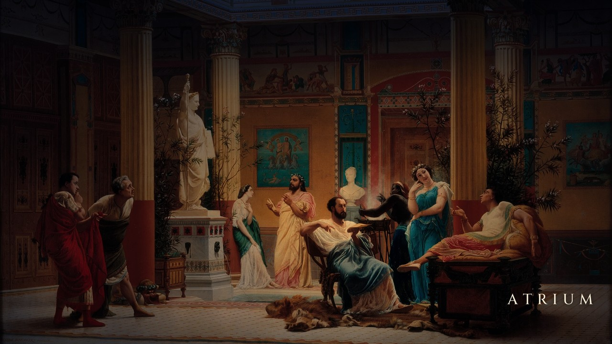

# atrium

**Домашний медиацентр у ТВ на Fedora + GNOME: 4K 120 Гц, HDR, звук бит в бит, игры, торренты и общая
папка — в одной тихой коробке размером с ладонь.**
*Home media PC for the TV on Fedora + GNOME: 4K 120 Hz, HDR, bit-perfect audio, games, torrents and a
network share in one quiet palm-sized box. English version is below.*



В этом репозитории всё, чтобы собрать такой же atrium с нуля, имея на руках только железо:

- пошаговая установка с объяснением каждого шага;
- настройки BIOS и ТВ;
- HDMI 2.1 (4K 120 Гц, HDR) на штатном порту одним параметром ядра — и как мы к этому месяц шли;
- все конфиги и наши программы;
- патчи;
- что ломается при обновлениях и как это вернуть.

## Что это

Маленький компьютер (Beelink SER5 MAX) у большого OLED-телевизора. Выглядит и ведёт себя как
приставка:
- включился и сразу показывает рабочий стол;
- управляется с телефона, геймпада или мыши;
- никогда ничего не спрашивает и не показывает уведомлений.

Внутри это полноценный Linux-сервер, который работает круглые сутки.

### Что умеет

- **Кино в лучшем качестве.** mpv с максимальным профилем: 4K HDR и Blu-ray Remux без пропусков кадров,
  видео декодирует видеокарта. Русская дорожка выбирается сама, субтитры по желанию.
- **Картинка.** 3840×2160 при **120 Гц**, полный цвет **RGB 4:4:4**, **HDR10** (BT.2020 / PQ), 10 бит,
  без сжатия — по штатному HDMI 2.1 обычным кабелем, без активных переходников. Фильм 24p на 120 Гц
  показывается ровно, каждый кадр по 5 раз, без рывков.
- **Звук бит в бит.** Внешний USB-ЦАП — единственная звуковая карта. Частота сама подстраивается под
  трек, от 44,1 до 192 кГц, без пересчёта.
- **Музыка.** fooyin (как foobar2000) для файлов, Spotify.
- **Браузер.** Chrome с Widevine (стриминговые сервисы), Firefox.
- **Игры.**
  - RetroDECK: PS1, PS2, PS3, PSP и другие консоли, с меню для геймпада;
  - Steam через Proton;
  - стрим игр с мощного ПК в 4K 60 Гц AV1 (Apollo → Moonlight), Steam Link.
- **Торренты.** Демон работает всегда. Бросил `.torrent` в общую папку с любого компьютера — фильм
  качается прямо на диск 2 ТБ.
- **Общая папка для Windows** без паролей: `\\atrium.lan\media`, видна в «Сети».
- **Управление.**
  - с телефона: тачпад и клавиатура, печатает и кириллицу, и любые символы;
  - RDP с компьютера: тот же экран;
  - SSH; геймпады DualSense и Xbox; экранная клавиатура.
- **Заставка Apple Aerial.** Через 15 минут простоя — ролики Apple в 4K (города, природа, МКС, океан),
  через 30 минут экран гаснет. Любое касание возвращает всё обратно. Пока идёт фильм, заставка не мешает.
- **Тихо и экономно.** В простое процессор тратит 3–4 Вт.
- **Видно, что происходит.**
  - в панели — загрузка CPU, GPU и аппаратного декодера: сразу видно, кто играет фильм, видеокарта или
    процессор;
  - скорость сети и температура;
  - на рабочем столе — заполнение дисков;
  - при входе по SSH — сводка состояния.

### Железо

| | |
|---|---|
| Бокс | Beelink SER5 MAX: AMD Ryzen 7 7735U (8 ядер / 16 потоков, до 4,75 ГГц), Radeon 680M, 24 ГБ LPDDR5 |
| Диски | NVMe 1 ТБ (система) + WD Blue SN5000 2 ТБ (медиа, второй слот M.2) |
| Сеть | 2,5 GbE, Wi-Fi 6, Bluetooth |
| ТВ | LG OLED65C3 по HDMI 2.1, пассивный кабель Ultra High Speed (48G) |
| Звук | USB-ЦАП SMSL |
| Софт | Fedora 44, GNOME 50 (Wayland), ядро 7.2, Mesa 26.2 |

Аппаратно декодируются H.264, HEVC (вкл. 10 бит), VP9 и AV1.

### Почему так, а не иначе

- **Apple TV 4K.** Отличная приставка для подписок. Но своих файлов по сети, звука бит в бит через ЦАП,
  торрентов, браузера, ПК-игр и эмуляторов на ней нет, либо всё это через сторонние приложения и с
  ограничениями.
- **Mac mini.** Mac — это компьютер, а не плеер для ТВ. Он быстрее, тише и экономнее, и HDMI 2.1 у него
  свой. Но:
  - конфигурация с 24 ГБ и 1 ТБ стоит около $1200, а память и диск распаяны навсегда. Здесь второй слот
    M.2: 2 ТБ добавили за $130;
  - частоту ЦАПа под трек на macOS переключают только отдельные плееры;
  - игр в Steam под Linux через Proton заметно больше, чем под macOS.
- **Мини-ПК на Windows.**
  - обновления сами перезагружают машину, система показывает рекламу и уведомления;
  - в HDR рабочий стол и обычное видео становятся тёмными. У нас Windows в HDR была тёмной, а GNOME
    показывает SDR-контент в HDR с нормальной яркостью;
  - здесь: ни одного всплывающего окна, обновления только вручную из консоли, каждая настройка записана
    в этом репозитории.
- **Nvidia Shield и Android-приставки.** Хороши для Kodi и подписок, но железо 2019 года. Ни ПК-игр, ни
  эмуляции PS3, ни сервера.

### Сколько стоит (примерно, $)

| Бокс | SSD 2 ТБ | Кабель HDMI 48G | ЦАП | Итого без ТВ |
|---|---|---|---|---|
| ~350 | ~130 | ~15 | 150–250 | **≈ 650–750** |

## Документация

| | Русский | English |
|---|---|---|
| Установка с нуля, по шагам | [docs/ru/install.md](docs/ru/install.md) | [docs/en/install.md](docs/en/install.md) |
| Железо, BIOS, ТВ, диски | [docs/ru/hardware.md](docs/ru/hardware.md) | [docs/en/hardware.md](docs/en/hardware.md) |
| Вывод на ТВ: HDMI 2.1, месяц поисков и где была правда | [docs/ru/tv-output.md](docs/ru/tv-output.md) | [docs/en/tv-output.md](docs/en/tv-output.md) |
| Обновления: что отлетает и как вернуть | [docs/ru/updates.md](docs/ru/updates.md) | [docs/en/updates.md](docs/en/updates.md) |
| Известные проблемы и решения | [docs/ru/problems.md](docs/ru/problems.md) | [docs/en/problems.md](docs/en/problems.md) |

## Что где лежит

```
rootfs/      наши файлы ровно по тем путям, где они лежат на atrium:
             rootfs/etc/samba/smb.conf  ->  /etc/samba/smb.conf
             (конфиги, службы, скрипты, наши расширения GNOME, обои, настройки пользователя ТВ)
patches/     патч для Unified Remote (только наши правки поверх файлов производителя)
src/         из чего что-то собирается: настройки GNOME (dconf), генератор обоев,
             сборка экранных клавиатур Unified Remote, старые версии для Intel NUC
lists/       установленные пакеты и flatpak-приложения
docs/        документация на русском и английском
```

Чего здесь **нет**:

- **Секретов.** Пароли, ключи и профили Wi-Fi каждый задаёт сам при установке.
- **Чужих программ и медиа.** Unified Remote, сторонние расширения GNOME, прошивки, BIOS, ролики Apple
  Aerial. Для них в документации есть ссылки, версии и контрольные суммы.

## Лицензии

- **Наше** — скрипты, конфиги, расширения `atrium-*`, патч, генераторы, документация: MIT, см. `LICENSE`.
- **Обои** — картина Гюстава Буланже «Репетиция „Флейтиста“ в атриуме помпейского дома принца
  Наполеона» (1861), общественное достояние, в нашей обработке.
- **Шрифт Cinzel** (подпись на обоях) — SIL Open Font License 1.1, `src/wallpaper/Cinzel-OFL.txt`.
- **Unified Remote** — собственность производителя. Патч содержит только наши изменения, файлов
  производителя в репозитории нет.

---

# atrium (English)

**A home media PC for the TV on Fedora + GNOME: 4K at 120 Hz, HDR, bit-perfect audio, games, torrents
and a network share — in one quiet palm-sized box.**

This repository holds everything needed to build the same atrium from scratch with nothing but the
hardware:

- a step-by-step install with the reason for every step;
- BIOS and TV settings;
- HDMI 2.1 (4K 120 Hz, HDR) on the box's own port with one kernel parameter — and the month it took us
  to get there;
- all configs and our own programs;
- patches;
- what breaks on updates and how to get it back.

## What it is

A small computer (Beelink SER5 MAX) next to a big OLED TV. It looks and behaves like a set-top box:
- it boots straight to the desktop;
- you control it from a phone, a gamepad or a mouse;
- it never asks anything and never shows notifications.

Inside it is a full Linux server that runs around the clock.

### What it does

- **Films at their best.** mpv with the maximum-quality profile: 4K HDR and Blu-ray remuxes without
  dropped frames, decoded by the GPU. The preferred audio track is picked automatically, subtitles on
  demand.
- **Picture.** 3840×2160 at **120 Hz**, full **RGB 4:4:4**, **HDR10** (BT.2020 / PQ), 10-bit, no
  compression — over the box's own HDMI 2.1 with an ordinary cable, no active adapters. 24p films on
  120 Hz are shown evenly, every frame 5 times, no judder.
- **Bit-perfect sound.** An external USB DAC is the only sound card. The sample rate follows the track,
  44.1 to 192 kHz, without resampling.
- **Music.** fooyin (foobar2000-like) for files, Spotify.
- **Browser.** Chrome with Widevine (streaming services), Firefox.
- **Games.**
  - RetroDECK: PS1, PS2, PS3, PSP and more, with a gamepad menu;
  - Steam with Proton;
  - streaming games from a powerful PC in 4K 60 Hz AV1 (Apollo → Moonlight), Steam Link.
- **Torrents.** The daemon always runs. Drop a `.torrent` into the share from any computer and the film
  downloads straight to the 2 TB drive.
- **Windows share** without passwords: `\\atrium.lan\media`, visible in Network.
- **Control.**
  - from a phone: touchpad and keyboard, types any language and symbol;
  - RDP from a PC: the same screen;
  - SSH; DualSense and Xbox gamepads; an on-screen keyboard.
- **Apple Aerial screensaver.** After 15 minutes idle — Apple's 4K clips (cities, nature, the ISS, the
  ocean), after 30 minutes the screen turns off. Any touch brings everything back. It never interrupts a
  film.
- **Quiet and frugal.** The CPU draws 3–4 W when idle.
- **You see what is going on.**
  - the top bar shows CPU, GPU and video-decoder load: you see at once whether the GPU or the CPU plays
    the film;
  - network speed and temperature;
  - disk usage on the desktop;
  - a status summary at SSH login.

### Hardware

| | |
|---|---|
| Box | Beelink SER5 MAX: AMD Ryzen 7 7735U (8 cores / 16 threads, up to 4.75 GHz), Radeon 680M, 24 GB LPDDR5 |
| Drives | NVMe 1 TB (system) + WD Blue SN5000 2 TB (media, second M.2 slot) |
| Network | 2.5 GbE, Wi-Fi 6, Bluetooth |
| TV | LG OLED65C3 over HDMI 2.1, a passive Ultra High Speed (48G) cable |
| Sound | SMSL USB DAC |
| Software | Fedora 44, GNOME 50 (Wayland), kernel 7.2, Mesa 26.2 |

Hardware decoding: H.264, HEVC (incl. 10-bit), VP9 and AV1.

### Why this and not something else

- **Apple TV 4K.** A great box for subscriptions. But your own files over the network, bit-perfect sound
  through a DAC, torrents, a browser, PC games and emulators are missing there, or come only through third-party
  apps with limits.
- **Mac mini.** A Mac is a computer, not a TV player. It is faster, quieter and more frugal, and it has
  native HDMI 2.1. But:
  - 24 GB and 1 TB cost about $1200, and the memory and storage are soldered for good. Here a second M.2
    slot took 2 TB for $130;
  - on macOS only some players switch the DAC rate per track;
  - Steam on Linux runs noticeably more games through Proton than on macOS.
- **A Windows mini PC.**
  - updates reboot it on their own, the system shows ads and notifications;
  - in HDR the desktop and normal video get dark. For us Windows was dark in HDR, while GNOME shows SDR
    content at normal brightness in HDR;
  - here: not a single popup, updates only by hand from the console, every setting written down in this
    repository.
- **Nvidia Shield and Android boxes.** Fine for Kodi and subscriptions, but 2019 hardware. No PC games, no
  PS3 emulation, no server.

### What it costs (approx., $)

| Box | 2 TB SSD | 48G HDMI cable | DAC | Total without the TV |
|---|---|---|---|---|
| ~350 | ~130 | ~15 | 150–250 | **≈ 650–750** |

## Documentation

See the table above: every document exists in Russian (`docs/ru/`) and English (`docs/en/`).

## What is where

```
rootfs/      our files at exactly the paths they have on atrium:
             rootfs/etc/samba/smb.conf  ->  /etc/samba/smb.conf
             (configs, services, scripts, our GNOME extensions, wallpaper, TV user settings)
patches/     the Unified Remote patch (only our changes on top of the vendor files)
src/         sources things are built from: GNOME settings (dconf), wallpaper generator,
             Unified Remote on-screen keyboard builder, old versions for an Intel NUC
lists/       installed packages and flatpak apps
docs/        documentation in Russian and English
```

What is **not** here:

- **Secrets.** Passwords, keys and Wi-Fi profiles are set by each person during the install.
- **Third-party software and media.** Unified Remote, third-party GNOME extensions, firmware, BIOS, Apple
  Aerial clips. The docs give links, versions and checksums for them.

## Licenses

- **Ours** — scripts, configs, `atrium-*` extensions, the patch, generators, documentation: MIT, see
  `LICENSE`.
- **Wallpaper** — Gustave Boulanger, "Rehearsal of 'The Flute Player' in the atrium of the Pompeian house
  of Prince Napoleon" (1861), public domain, our edit.
- **Cinzel font** (the caption on the wallpaper) — SIL Open Font License 1.1, `src/wallpaper/Cinzel-OFL.txt`.
- **Unified Remote** belongs to its vendor. The patch holds only our changes; no vendor files are in this
  repository.
